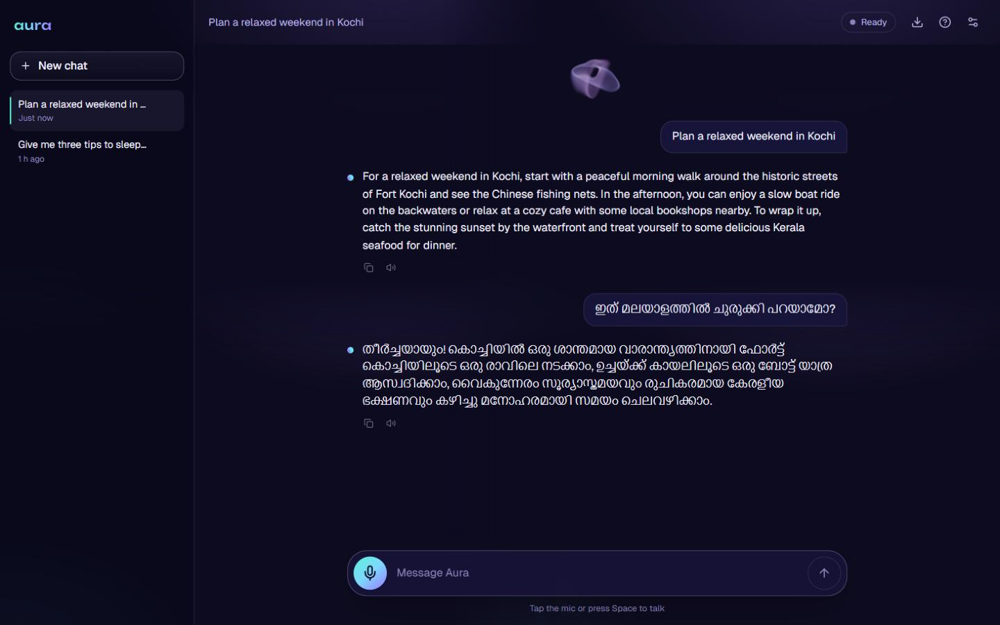
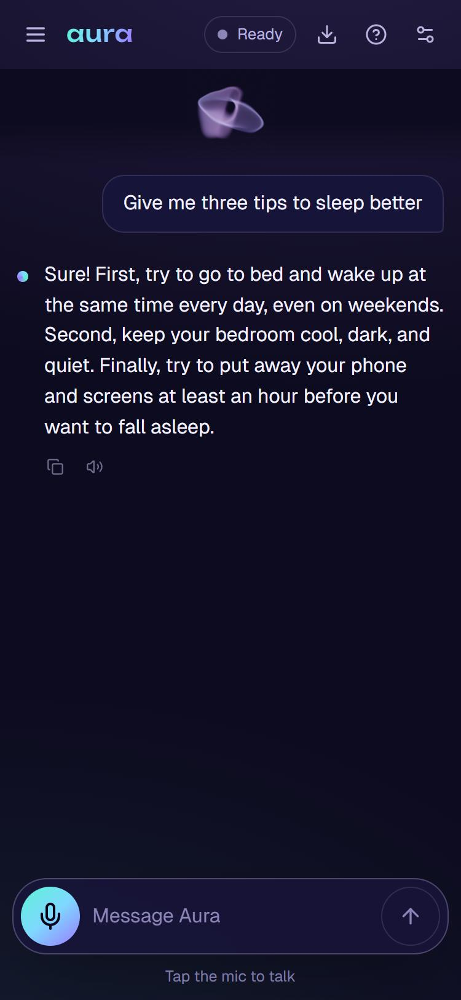
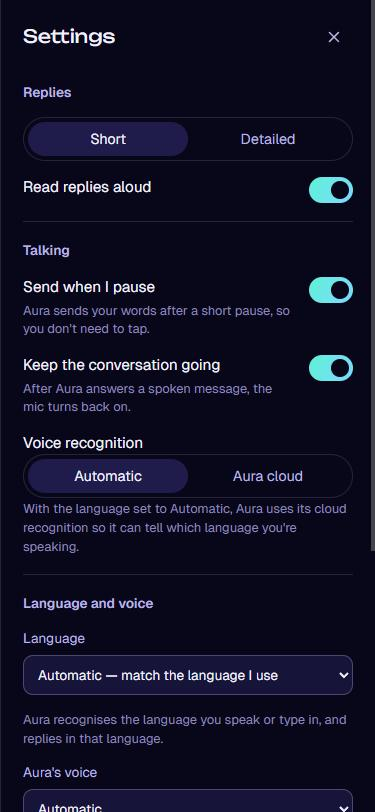

# Aura

Aura is a voice assistant that runs in the browser. Tap the mic and talk, or type. Aura understands the language you use, answers on screen and reads the answer aloud, starting as soon as the first sentence arrives.

**Live:** https://auraa-voice.netlify.app



<p align="center">
  
  &nbsp;&nbsp;
  
</p>

## Features

- **Talk or type.** Your words appear while you speak.
- **Automatic language (default).** Aura works out which language you speak or type, and replies in that language. Pick a language in Settings and Aura always replies in it, whatever language you use.
- **Languages:** English (US, UK, India), Hindi, Malayalam, Tamil, Spanish, French and German.
- **Hands-free mode.** Aura sends your message when you pause, then listens again after it answers.
- **Spoken replies.** Replies stream in and are read aloud sentence by sentence. Tap the mic while Aura is speaking to cut in.
- **Works in any browser with a microphone.**
  - If the browser has no speech recognition of its own (Firefox, Brave, in-app browsers), Aura records you and transcribes on its server.
  - If the browser has no voice for the language (Malayalam, for example), Aura uses a cloud voice. The status shows *Preparing voice* while it loads.
- **Saved chats.** Kept in this browser only, with a chat list. Delete or download any chat as text.
- **Settings:** reply length, read aloud on or off, language, voice, speaking speed, voice recognition mode.
- **Copy or replay** any reply.
- **Keyboard shortcuts:** `Space` talk or send, `Esc` stop, `/` focus the message box.
- **Responsive.** Works on phone, tablet and desktop.

## How it works

```
Browser                                       Netlify Functions
───────────────────────────────────           ────────────────────────────────────────
Mic ─┬─ Web Speech API (Chrome, manual language)
     └─ recorder → 16 kHz WAV ── POST ──▶   /api/transcribe   Gemini speech-to-text, detects the language
Chat history (localStorage)    ── POST ──▶   /api/chat         Gemini (Hugging Face backup), streamed reply
                               ◀─ stream ─                       in the chosen or detected language
Speaker ─┬─ speechSynthesis (browser voice, when one exists for the language)
         └─ <audio> ◀──────────── POST ──▶   /api/speak        Google Cloud TTS or Gemini TTS
```

API keys stay on the server. Each function checks its input and limits how often one visitor can call it. There is no separate backend to host.

## Project structure

```text
frontend/
  netlify/functions/
    chat.mjs          # AI replies              (/api/chat)
    transcribe.mjs    # speech-to-text          (/api/transcribe)
    speak.mjs         # cloud voice             (/api/speak)
  netlify/lib/common.mjs  # shared helpers: Gemini calls, languages, rate limits
  src/
    App.jsx           # main screen and conversation flow
    components/       # orb visualiser, sidebar, settings, help, markdown
    hooks/            # browser + cloud speech-to-text, speech queue, saved state
    lib/              # streaming client, audio encoding, language detection, text helpers
  public/favicon.svg
  netlify.toml        # Netlify build settings
docs/images/          # README screenshots
```

## Run it locally

Requires Node.js 18 or newer.

```bash
npm install
npm run dev:netlify     # site + functions together (Netlify CLI)
```

Put your keys in `frontend/.env` for local testing. The file is git-ignored.

```
GEMINI_API_KEY=...
```

`npm run dev` starts the site on its own, without the `/api` functions.

## Configuration

Set these in Netlify → Project configuration → Environment variables, and mark the keys as secret. At least one AI key is needed. Redeploy after changing a value.

| Variable | Purpose |
| --- | --- |
| `GEMINI_API_KEY` | Google AI Studio key (free tier works). Replies use `gemini-flash-lite-latest`, then `gemini-flash-latest`. The same key powers speech-to-text and the cloud voice. |
| `GEMINI_MODEL` | Optional. A Gemini model to try first. |
| `GOOGLE_TTS_API_KEY` | Optional. A Google Cloud Text-to-Speech key, which needs a project with billing (the free tier is about 1M characters a month). Gives a faster, more reliable voice for languages the browser can't speak, and is tried before Gemini's voice. |
| `HUGGINGFACE_API_KEY` | Optional backup. A Hugging Face token with permission to call Inference Providers. |
| `HUGGINGFACE_MODEL` | Optional. Tried first. The defaults are Llama 3.1 8B, then Gemma 3 12B, Qwen 2.5 72B and GPT-OSS 20B. |
| `HUGGINGFACE_BASE_URL` | Optional. Defaults to `https://router.huggingface.co/v1/chat/completions`. |

**Free-tier note:** Gemini's free voice has a daily limit. When it runs out, Aura shows the reply as text only and says so. Browser voices, used for English and most European languages, have no limit.

## Deploying

Pushing to `main` deploys to Netlify automatically. Other branches get a preview at `<branch>--auraa-voice.netlify.app`.

## Privacy

Chats are stored only in the visitor's browser. Messages, and recordings when cloud speech-to-text is used, are sent to the AI provider (Google Gemini, or Hugging Face as a backup) to produce replies and are not stored by Aura.
