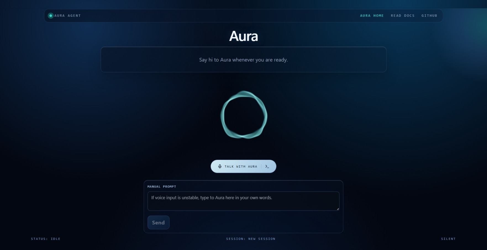

# Aura

Aura is a voice assistant that runs in the browser. Tap the mic and talk, or type. Aura answers on screen and out loud, starting to speak as soon as the first sentence of its reply arrives.

**Live:** https://auraa-voice.netlify.app



## Features

- Talk or type; your words appear live while you speak
- Hands-free mode: Aura sends your message when you pause, and listens again after it answers
- Streaming replies that are spoken sentence by sentence
- Tap the mic while Aura is speaking to cut in
- Saved chats (in this browser only), with a chat list, delete and download as text
- Settings: reply length, read aloud on/off, language (English US/UK/India, Hindi, Malayalam, Tamil, Spanish, French, German), voice, speaking speed
- Works in any browser with a microphone: if the browser's own speech recognition isn't available (Firefox, Brave, in-app browsers), Aura records and transcribes through its server; if the browser has no voice for the chosen language (e.g. Malayalam), Aura speaks with a cloud voice
- Copy or replay any reply
- Keyboard shortcuts: `Space` talk/send, `Esc` stop, `/` focus the message box
- Works on phone, tablet and desktop

## How it works

```
Browser                                   Netlify
──────────────────────────────            ─────────────────────────────────
Mic → Web Speech API (speech-to-text)
Chat history (localStorage)  ── POST ──▶  /api/chat  (frontend/netlify/functions/chat.mjs)
                                             • validates and trims the conversation
                                             • rate limits per visitor
                                             • calls Gemini or Hugging Face, with fallback
Speaker ← speechSynthesis    ◀─ stream ──    • streams the reply back (server-sent events)
```

API keys stay on the server. There is no separate backend to host.

## Project structure

```text
frontend/
  netlify/functions/chat.mjs        # AI replies (/api/chat)
  netlify/functions/transcribe.mjs  # speech-to-text fallback (/api/transcribe)
  netlify/functions/speak.mjs       # cloud voice (/api/speak)
  netlify/lib/common.mjs            # shared helpers
  src/
    App.jsx                    # main screen and conversation logic
    components/                # orb visualiser, sidebar, settings, help, markdown
    hooks/                     # speech-to-text, speech queue, saved state
    lib/                       # streaming client, text helpers
  public/favicon.svg
frontend/netlify.toml          # Netlify build settings
```

## Run it locally

Requires Node.js 18+.

```bash
npm install
cd frontend
npx netlify dev        # runs the site and the /api/chat function together
```

Create `frontend/.env` with your key for local testing (it's git-ignored):

```
HUGGINGFACE_API_KEY=hf_...
```

`npm run dev` starts the site alone (without the AI endpoint).

## Configuration

Set these in Netlify → Project configuration → Environment variables (mark keys as secret). At least one key is needed; if both are set, Gemini is tried first and Hugging Face is the backup.

| Variable | Purpose |
| --- | --- |
| `GEMINI_API_KEY` | Google AI Studio key (free tier). Replies use `gemini-flash-lite-latest` (fastest), then `gemini-flash-latest`. Also powers the cloud voice and speech-to-text fallback |
| `GEMINI_MODEL` | Optional: Gemini model to try first |
| `HUGGINGFACE_API_KEY` | Hugging Face token with permission to call Inference Providers |
| `HUGGINGFACE_MODEL` | Optional: tried first. Defaults to Llama 3.1 8B, then Gemma 3 12B, Qwen 2.5 72B, GPT-OSS 20B |
| `HUGGINGFACE_BASE_URL` | Optional: defaults to `https://router.huggingface.co/v1/chat/completions` |

## Deploying

Pushing to `main` deploys to Netlify automatically.

## Privacy

Chats are stored only in the visitor's browser. Messages are sent to the AI provider (Google Gemini or Hugging Face) to generate replies.
